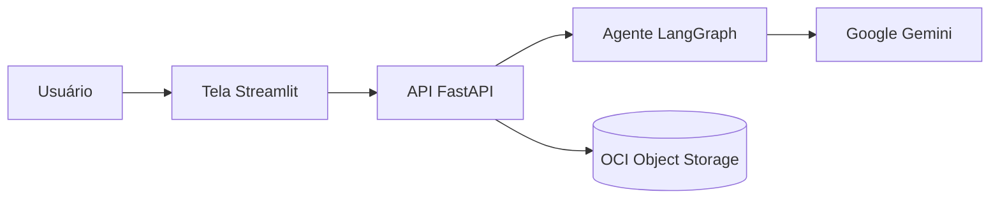
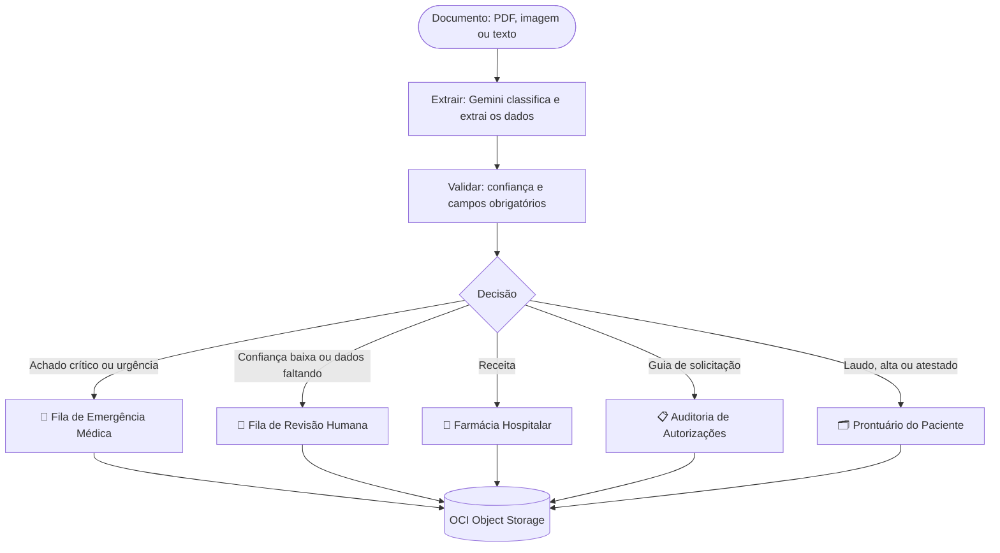

# 🏥 MediFlow

**Agente autônomo para triagem, extração e roteamento de documentos clínicos**

*"A informação existe. O MediFlow faz ela chegar."*

Projeto da **Equipe 2** no Hackathon ONE G10 (Oracle Next Education, Alura e No Country).

## Demo online

- **Tela:** http://144.22.197.211:8501/
- **API (Swagger):** http://144.22.197.211:8000/docs

Hospedado em uma máquina virtual Always Free da Oracle Cloud (OCI Compute), na região de São Paulo.

## O problema

Hospitais, laboratórios e operadoras de saúde recebem todos os dias milhares de documentos diferentes: receitas, laudos, guias de autorização, relatórios de alta e atestados. Equipes administrativas leem esses papéis e PDFs manualmente para digitar os dados em sistemas, um processo lento, caro e sujeito a erros. Quando um laudo crítico fica parado na fila, o paciente em urgência espera.

## A solução

O MediFlow recebe o documento em **PDF, imagem ou texto**, usa IA multimodal para **classificar** o tipo, **extrair** os dados clínicos, **avaliar a confiança** da leitura e **rotear** automaticamente para o destino certo. Casos ambíguos vão para **revisão humana** (Human-in-the-Loop), e casos urgentes nunca esperam.

| Documento | Destino |
|---|---|
| Receita | Farmácia Hospitalar + Prontuário (alerta ao farmacêutico se houver medicamento controlado) |
| Laudo normal | Prontuário Eletrônico do Paciente |
| Laudo alterado | Prontuário + alerta ao médico solicitante |
| Laudo crítico ou pedido urgente | Fila de Emergência Médica + alerta ao plantão |
| Guia de solicitação | Auditoria de Autorizações |
| Relatório de alta | Prontuário + Farmácia (medicamentos para casa) |
| Atestado | Prontuário |
| Leitura duvidosa ou dados faltando | Fila de Revisão Humana |

## Arquitetura



Tela e API rodam em uma máquina OCI Compute Always Free, como serviços do sistema.

## Fluxo de decisão do agente



**Regras de segurança**

- O agente alerta, mas quem decide é sempre o médico ou o farmacêutico.
- Confiança abaixo de 75% ou campo obrigatório ausente leva o documento para revisão humana.
- Urgência nunca espera: vai para a Emergência mesmo com dúvidas, e as dúvidas seguem também para revisão.
- Se o Gemini estiver instável ou atingir o limite de uso, o agente passa para outros modelos e para uma chave reserva; se tudo esgotar, o documento vai para revisão humana com um aviso claro.
- Somente dados fictícios, em respeito à LGPD.

## Organização no OCI Object Storage (Always Free)

```
mediflow-documentos-clinicos/
├── recebidos/            documento original, como chegou
├── processados/
│   ├── urgentes/
│   ├── farmacia/
│   ├── auditoria_autorizacoes/
│   └── prontuario/
├── auditoria_humana/     aguardando revisão
├── revisoes/             decisões dos auditores
└── pacientes/<nome>/     histórico do paciente (prontuário)
```

## Tecnologias

Python 3.13, Google Gemini (multimodal), LangGraph, Pydantic, FastAPI com Swagger, Streamlit, Oracle Cloud Infrastructure Object Storage e OCI Compute (camada Always Free).

## Como executar localmente

**Pré-requisitos:** Python 3.13, uma chave do Gemini ([AI Studio](https://aistudio.google.com/apikey)) e um bucket no OCI com um link pré-autenticado de leitura e escrita.

```bash
git clone https://github.com/No-Country-simulation/G10-BRASIL-Equipe-2-MediFlow.git
cd G10-BRASIL-Equipe-2-MediFlow/backend
python -m venv .venv
source .venv/Scripts/activate      # no Linux ou Mac: source .venv/bin/activate
pip install -r requirements.txt
```

Copie o arquivo `backend/.env.example` para `backend/.env` e preencha a chave do Gemini e o link do OCI. Opcionalmente, adicione `GEMINI_API_KEY_RESERVA` com uma segunda chave, usada quando a principal atinge o limite.

**Terminal 1, API:**

```bash
cd backend
uvicorn app.main:app --reload
```

Documentação interativa (Swagger): http://127.0.0.1:8000/docs

**Terminal 2, tela:**

```bash
cd backend
streamlit run ../frontend/app.py
```

Tela: http://localhost:8501

## Endpoints

| Método | Rota | Descrição |
|---|---|---|
| GET | `/` | Status da API |
| POST | `/triagem` | Triagem de documento em texto (formato JSON do enunciado) |
| POST | `/triagem/arquivo` | Triagem de PDF ou imagem |
| GET | `/auditoria` | Documentos aguardando revisão humana |
| POST | `/auditoria/{documento_id}/decisao` | Registra a decisão do auditor |
| GET | `/documentos/{caminho}` | Consulta um resultado salvo no OCI |

## Demonstração dos 3 cenários

```bash
cd backend
python testar_agente.py
```

| Cenário | Documento | Resultado |
|---|---|---|
| Rotina | Receita comum | Farmácia Hospitalar + Prontuário |
| Urgência | Laudo de tromboembolismo pulmonar agudo | Fila de Emergência + alerta ao plantão |
| Ambiguidade | Receita ilegível, sem CRM | Fila de Revisão Humana |

## Visão de futuro

Controle de acesso ao prontuário pelo próprio paciente (ou responsável legal), conforme a LGPD; integração com a RNDS (Rede Nacional de Dados em Saúde); comparação de medicamentos pelo princípio ativo na base da Anvisa; e redução de exames repetidos com o histórico unificado.

## Equipe

Equipe 2 do Hackathon ONE G10.

## Links

- **Demo online:** http://144.22.197.211:8501/
- **API (Swagger):** http://144.22.197.211:8000/docs
- **Vídeo demo:** (a definir)